<div align="center">


<br>

[](https://www.python.org/)
[](https://streamlit.io/)
[](https://supabase.com/)
[](https://github.com/pgvector/pgvector)
<br>
[](https://www.databricks.com/)
[](https://www.mongodb.com/atlas)
[](https://ai.google.dev/gemini-api/docs/embeddings)

**[Tutor access](#-tutor-access)** ·
**[Architecture](#%EF%B8%8F-architecture)** ·
**[Run it](#-run-it-locally)** ·
**[Build the database](#%EF%B8%8F-build-the-database-run-order)** ·
**[PostgreSQL](#-operational-role-postgresql-two-schemas)** ·
**[pgvector](#-vector-role-pgvector-semantic-search)** ·
**[Dashboard](#-the-integration-dashboard)** ·
**[Team](#-team-and-contributions)**

</div>

---

> [!IMPORTANT]
> **Tutor, start here:** [🔐 Tutor access](#-tutor-access) lists every platform, the group account and a two-minute check for each database. Passwords and keys are **not** in this public repository. They are in the private access note submitted with the project on Moodle.

## ✈️ Project at a glance

An airline sells seats on its own **mainline** flights and through a **regional partner** whose booking system was designed very differently. This project integrates the two operational databases, analyses them in a warehouse, adds passenger feedback that only exists in a NoSQL store, and lets staff search past disruptions **by meaning**, all from one live dashboard.

| # | Role | Platform | What lives there | Owner |
|:-:|---|---|---|---|
| 1 | **Operational** (relational) | 🐘 PostgreSQL on Supabase | two deliberately different schemas: `mainline_carrier` (3NF, 6 tables) and `regional_partner` (denormalised, 4 tables) | Member 1 |
| 2 | **Analytical** (warehouse) | 🧱 Databricks | bronze → staging → star schema, with the "Sync now" refresh | Member 2 |
| 3 | **NoSQL** | 🍃 MongoDB Atlas | `passenger_feedback` (imported IDs + reviews, ratings, likes), `baggage_events` | Member 3 |
| 4 | **Vector** | 🧭 PostgreSQL + pgvector | `vector_store.flight_note_embeddings`: 1536-d Gemini embeddings of flight disruption notes | Member 1 |

<table>
<tr>
<td align="center"><h3>10</h3>operational tables</td>
<td align="center"><h3>2</h3>PostgreSQL schemas</td>
<td align="center"><h3>54</h3>embedded flight notes</td>
<td align="center"><h3>7</h3>cross-database flows</td>
<td align="center"><h3>4</h3>dashboard pages</td>
</tr>
</table>

---

## 🗺️ Architecture

<picture>
  <source media="(prefers-color-scheme: dark)" srcset="docs/assets/architecture-dark.svg">
  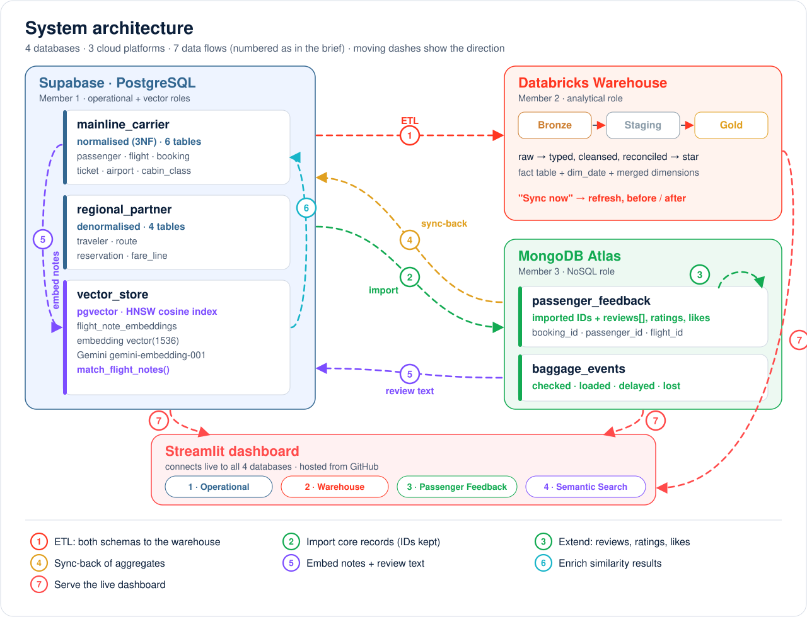
</picture>

| Flow | From → To | Named objects | Code |
|:-:|---|---|---|
| **1** | PostgreSQL (both schemas) → Databricks | all 10 operational tables → bronze → staging → star schema | Member 2's ETL notebooks |
| **2** | PostgreSQL → MongoDB (import) | `booking_id`, `passenger_id`, `flight_id` copied into `passenger_feedback` with IDs preserved | Member 3's import script |
| **3** | MongoDB (extend) | `reviews[]` (rating, comment, date), `photo_likes`, `baggage_events` | Member 3's extend script |
| **4** | MongoDB → PostgreSQL | aggregates → `mainline_carrier.flight.review_count`, `avg_rating`, `photo_like_total` | Member 3's sync-back ([contract](docs/schema_design.md#contract-for-member-3-mongodb--flow-4)) |
| **5** | PostgreSQL / MongoDB → pgvector | `flight.notes` (+ optional `reviews[].comment`) → `vector_store.flight_note_embeddings` | [`vector/embed_flight_notes.py`](vector/embed_flight_notes.py) |
| **6** | pgvector → PostgreSQL | `vector_store.match_flight_notes()` joins matches back to `flight`, `airport`, `ticket` | [`vector/01_pgvector_setup.sql`](vector/01_pgvector_setup.sql) |
| **7** | all four → Streamlit | live views, search, booking form, Sync now, feedback form | [`dashboard/`](dashboard/) |

---

## 🔐 Tutor access

> [!NOTE]
> All platforms are registered under the group's **depersonalised account**. The password for each platform is in the **private access note** on Moodle, never in GitHub.

| Platform | Open | Sign in with | What to look at |
|---|---|---|---|
| 📊 **Streamlit dashboard** | the app link in the Moodle access note | no login needed | pages 1–4; every page reads live data |
| 🐘 **Supabase** (PostgreSQL + pgvector) | [supabase.com/dashboard](https://supabase.com/dashboard) | group account | **Table Editor** → schemas `mainline_carrier`, `regional_partner`, `vector_store` · **SQL Editor** → the checks below |
| 🧱 **Databricks** | workspace link in the Moodle access note | group account | **Catalog** → `workspace` → `airline_bronze` / `airline_staging` / `airline_gold` · **Jobs & Pipelines** → `airline_etl_flow1` · **Workspace** → Git folder `databricks/` · **SQL Editor** → the checks in [the warehouse section](#-analytical-role-databricks-warehouse) |
| 🍃 **MongoDB Atlas** | [cloud.mongodb.com](https://cloud.mongodb.com) | group account | collections `passenger_feedback`, `baggage_events` |
| 🐙 **GitHub** | [this repository](https://github.com/it8417-group2-airline/airline-flight-booking) | public | code and [commit history per member](https://github.com/it8417-group2-airline/airline-flight-booking/commits/main) |

<details>
<summary><b>🐘 Two-minute check of PostgreSQL and pgvector</b> (paste into the Supabase SQL Editor)</summary>

<br>

```sql
-- 1. Both operational schemas are populated
SELECT 'mainline_carrier.flight'       AS table_name, count(*) FROM mainline_carrier.flight
UNION ALL SELECT 'mainline_carrier.booking',        count(*) FROM mainline_carrier.booking
UNION ALL SELECT 'regional_partner.route',          count(*) FROM regional_partner.route
UNION ALL SELECT 'regional_partner.reservation',    count(*) FROM regional_partner.reservation
UNION ALL SELECT 'vector_store.flight_note_embeddings', count(*) FROM vector_store.flight_note_embeddings;

-- 2. A non-trivial query (view): on-time performance per route
SELECT * FROM mainline_carrier.v_on_time_performance_by_route ORDER BY on_time_pct;

-- 3. Embeddings are searchable: past flights most similar to flight 28 (sandstorm, 130 min late)
SELECT flight_number, route, flight_status, delay_min, passengers, round(similarity::numeric, 3) AS similarity
FROM vector_store.match_flight_notes(
       (SELECT embedding FROM vector_store.flight_note_embeddings
        WHERE flight_id = 28 AND source_type = 'flight_notes'), 6, 1.0)
WHERE flight_id <> 28;
```

Free-text search (a new sentence embedded live by Gemini) is on dashboard page 4, or from a terminal: `python vector/similarity_search.py "flight delayed by weather at a connecting hub"`.

</details>

---

## 🚀 Run it locally

**You need** Python 3.12 and Git. The databases are already in the cloud, so you don't install any of them.

```bash
git clone https://github.com/it8417-group2-airline/airline-flight-booking.git
cd airline-flight-booking
python -m venv .venv
# Windows:  .venv\Scripts\Activate.ps1        macOS / Linux:  source .venv/bin/activate
pip install -r requirements.txt
```

**Secrets.** Copy [`.streamlit/secrets.toml.example`](.streamlit/secrets.toml.example) to `.streamlit/secrets.toml` and fill in the values from the Moodle access note. That file is git-ignored in every folder.

```toml
[postgres]
url = "postgresql://postgres.<project-ref>:<db-password>@aws-1-<region>.pooler.supabase.com:5432/postgres"

[embeddings]
GEMINI_API_KEY = "<gemini-api-key>"

[databricks]                      # page 2 (warehouse); only the token is secret
host      = "dbc-6128b67f-20a8.cloud.databricks.com"
http_path = "/sql/1.0/warehouses/64e0559336604ed6"
token     = "<databricks-personal-access-token>"   # scopes: sql + jobs
job_id    = 70626669880455
```

**Start the dashboard from the repository root**, so Streamlit finds `.streamlit/secrets.toml`:

```bash
streamlit run dashboard/app.py
```

**Command-line scripts** (Flow 5 and Flow 6) read environment variables instead. All of them are listed in [`.env.example`](.env.example).

```powershell
$env:DATABASE_URL   = "postgresql://..."      # bash: export DATABASE_URL="postgresql://..."
$env:GEMINI_API_KEY = "..."
python vector/embed_flight_notes.py                       # embed new or changed notes only
python vector/similarity_search.py "crew shortage caused the delay" --k 3
```

---

## 🏗️ Build the database (run order)

The live Supabase database is **already built**. Only follow this to rebuild from scratch.

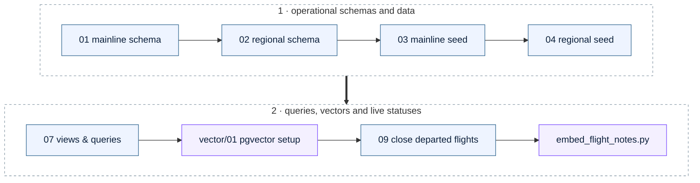

| File | Purpose | Safe to re-run? |
|---|---|:-:|
| `sql/postgres/01` · `02` | create the two schemas, keys, constraints, audit triggers, RLS | ⚠️ **drops the schema** |
| `sql/postgres/03` · `04` | realistic seed data with planted data-quality problems (snapshot 20 Nov 2026) | ❌ empty tables only |
| `sql/postgres/05` · `06` | CRUD demonstrations (run one section at a time) | ✅ cleans up after itself |
| `sql/postgres/07` | 3 views + 1 cross-schema query | ✅ |
| `vector/01` | pgvector extension, embeddings table, HNSW index, `match_flight_notes()` | ⚠️ **drops the embeddings** |
| `sql/postgres/09` | `close_departed_flights()`: keeps statuses realistic as time passes | ✅ run before every demo |
| `vector/02` | similarity search written out in SQL (for the report and viva) | ✅ |
| `sql/postgres/08` · `10` · `12` · `vector/03` | one-off upgrades of the live database (already applied) | n/a |
| `sql/postgres/11` | optional read-only login (`etl_reader`) with RLS policies | ✅ |

> [!WARNING]
> If `01` is ever re-run, re-run `03`, `07` and `09` afterwards. `01` drops the views and `close_departed_flights()`. It restores the embeddings' foreign key itself.

---

## 🐘 Operational role: PostgreSQL, two schemas

Same business, two designs. The differences are deliberate, so the ETL has real reconciliation work to do.

| Entity | `mainline_carrier` (normalised) | `regional_partner` (denormalised) | Difference |
|---|---|---|---|
| Customer | `passenger` | `traveler` | first + last name vs one `full_name`; SERIAL vs text key `TRV-0001`; date vs text birth date |
| Flight | `flight` + `airport` | `route` | airport-code FKs vs city names; actual times vs `delay_minutes` |
| Booking | `booking` | `reservation` | SERIAL vs BIGINT key; cabin per ticket vs one free-text `travel_class` |
| Ticket | `ticket` | `fare_line` | price = `base_fare × fare_multiplier` vs fare **copied** from `route` |
| Cabin | `cabin_class` | (none) | lookup table vs `'Economy'`, `'ECONOMY'`, `'econ'`, `'Y'` |

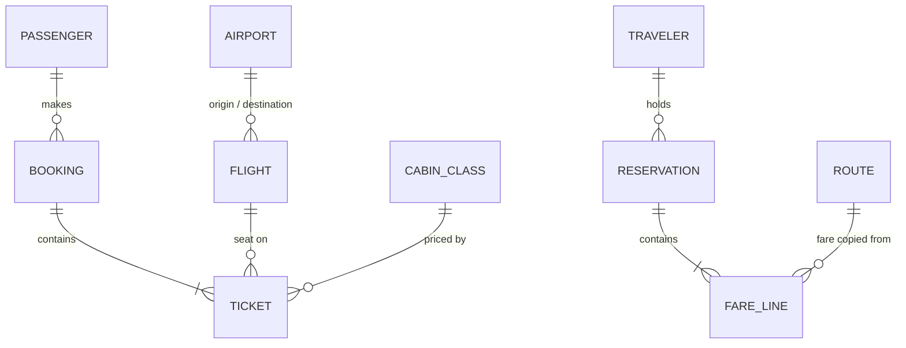

**What's in the scripts**

- **Keys and rules.** PK/FK everywhere, `UNIQUE (flight_id, seat_number)` (no double-booked seats), `CHECK` constraints on statuses, fares, ratings and arrival after departure, and `ON DELETE CASCADE` from booking to ticket.
- **Audit columns for incremental ETL.** `updated_at TIMESTAMPTZ` (mainline) vs `last_modified TIMESTAMP` in UTC (regional), both kept current by triggers.
- **Columns the ETL drops.** At least 2 per table, marked `[ETL-DROP]`, e.g. `flight.crew_manifest_ref` and `reservation.checkin_kiosk_code`.
- **Planted data-quality problems** for the cleansing step: the same 10 people in both schemas, duplicate travellers and fare lines, NULLs, 4 birth-date formats, mixed-case cities, classes and currencies, and USD fares. All are listed in [`docs/schema_design.md`](docs/schema_design.md#planted-data-quality-issues).
- **CRUD** on both schemas ([`05`](sql/postgres/05_crud_mainline_carrier.sql), [`06`](sql/postgres/06_crud_regional_partner.sql)), including a live demo of the **update anomaly** of the denormalised design.

| Non-trivial query ([`07`](sql/postgres/07_views_and_queries.sql)) | Technique |
|---|---|
| `mainline_carrier.v_on_time_performance_by_route` | 4-table join (airport joined twice), pre-aggregated CTE to avoid double counting, `FILTER` |
| `regional_partner.v_revenue_per_cabin` | `CASE` cleansing of free-text classes, USD → BHD conversion |
| `regional_partner.v_route_performance` | the same question on the other schema; city-name cleansing; `delay_not_reported` counts NULL delays |
| customers in both schemas | cross-schema join on `lower(email)` (the duplicates the ETL merges) |

📄 Full column-by-column design, ER diagrams, the ETL notes for Member 2 and the Flow 4 contract for Member 3: **[docs/schema_design.md](docs/schema_design.md)**.

---

## 🧭 Vector role: pgvector semantic search

Staff describe a disruption in their own words, for example *"flight delayed by weather at a connecting hub"*. The system finds past flights whose notes **mean** the same thing, even when they share no keywords, and adds operational facts from the relational tables.

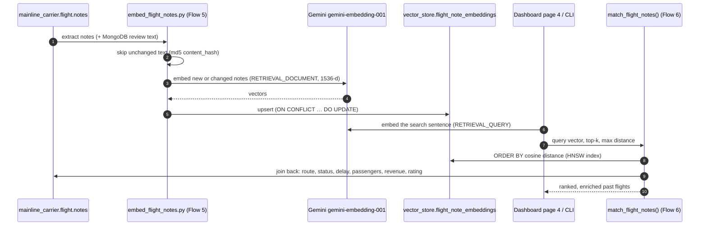

| Design choice | Why |
|---|---|
| **Gemini `gemini-embedding-001` at 1536 dimensions** | matches the `vector(1536)` column the task division asks for; free tier; separate task types for stored notes and search queries. The same model must embed both sides. |
| **HNSW index, `vector_cosine_ops`** | no training step (unlike IVFFlat), good recall on a small, growing table, supports inserts |
| **Incremental embedding** | `md5(notes)` is stored, so only new or changed notes call the API. A model change triggers a re-embed. |
| **Enrichment inside one SQL function** | the dashboard and the CLI share the same logic: only flights that have **already departed**, delay never negative, refunded tickets excluded |
| **MongoDB review text (optional)** | Flow 5 also embeds `passenger_feedback.reviews[].comment`; reviews for unknown flights are skipped, not fatal |

<details>
<summary><b>Live result on Supabase</b> (24 Nov 2026): past flights most similar to flight 28 <i>(DM105, sandstorm, 130 min late)</i></summary>

<br>

| Rank | Flight | Route | Matched note (summary) | Cosine similarity |
|:-:|---|---|---|:-:|
| 1 | DM107 | JED → BAH | fog | **0.882** |
| 2 | DM105 | RUH → BAH | bird strike | **0.871** |
| 3 | DM112 | BAH → LHR | strong winds | **0.863** |
| 4 | DM111 | MCT → BAH | late transfer bag | **0.861** |
| 5 | DM114 | BAH → CDG | thunderstorm | **0.861** |

Three of the top four are weather or operational delays: the stored Gemini vectors capture meaning, not keywords.

</details>

---

## 📊 The integration dashboard

A live Streamlit app, not a static report: every page queries the databases on each interaction, and users can **change** data and watch the system respond.

| Requirement from the brief | Where |
|---|---|
| View into the operational database, **both schemas** | Page 1: browse tables, on-time views, business queries |
| Working **semantic-search box** with relational enrichment | Page 4 |
| **"Sync now"** with before/after | Page 2: runs the Databricks Job `airline_etl_flow1` through the Jobs API, follows its 4 tasks live, then shows bronze, staging and `fact_ticket` counts and the charts **before and after**. A booking made on page 1 is the visible change |
| **≥ 2 further interactive elements** | Page 1: two-schema comparison toggle, "simulate a new booking" form (writes to either schema). Page 2: carrier filter (mainline only / regional only / combined). Page 4: Flow 5 "run embedding pipeline" button. Page 3: review form (Member 3) |
| View into MongoDB (imported + extended data) | Page 3 (Member 3) |
| View into the warehouse | Page 2: KPI summary, bronze → staging → gold pipeline, on-time chart, ticket volumes, revenue by route, top passengers, fare reconciliation |

<p align="center">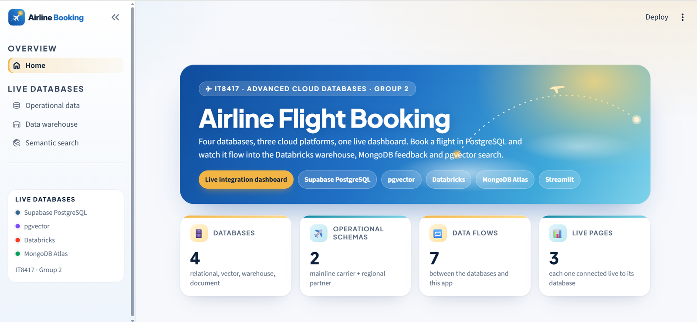<br>
<sub><b>Home</b>: sidebar navigation, the four live pages and the seven data flows</sub></p>

<table>
<tr><th colspan="2" align="left">📄 Page 1 · Operational data (Member 1)</th></tr>
<tr>
<td width="50%">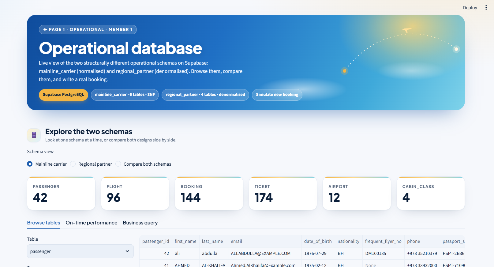<br><sub><b>Both schemas live</b>: row counts and the table browser</sub></td>
<td width="50%">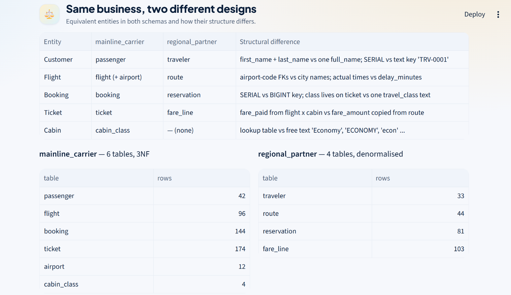<br><sub><b>Two-schema comparison toggle</b>: same entities, different designs</sub></td>
</tr>
<tr>
<td width="50%">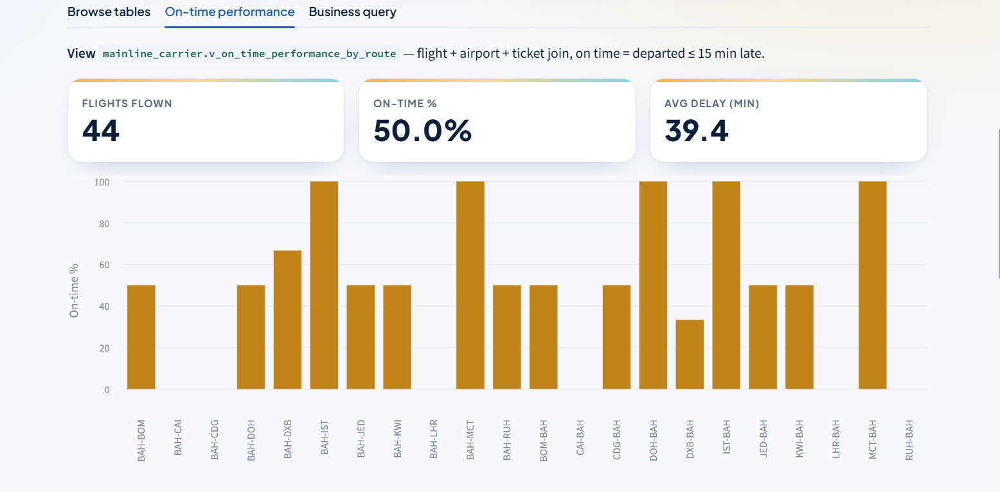<br><sub><b>On-time performance view</b>: <code>v_on_time_performance_by_route</code> as KPIs and a chart</sub></td>
<td width="50%">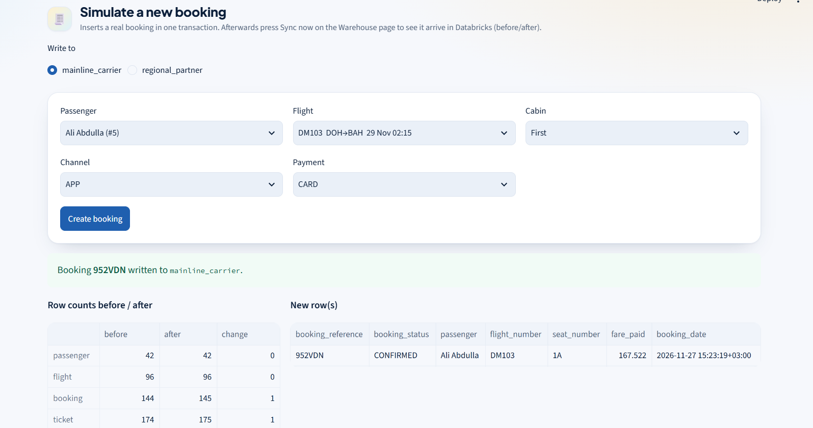<br><sub><b>Simulate a new booking</b>: one transaction, before / after counts</sub></td>
</tr>
<tr><th colspan="2" align="left">📄 Page 2 · Data warehouse (Member 2)</th></tr>
<tr>
<td width="50%">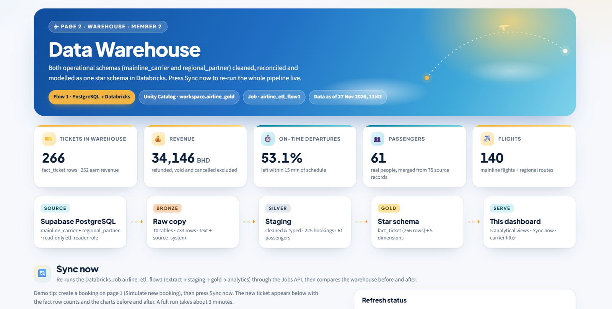<br><sub><b>Star schema KPIs</b> and the bronze → staging → gold pipeline</sub></td>
<td width="50%">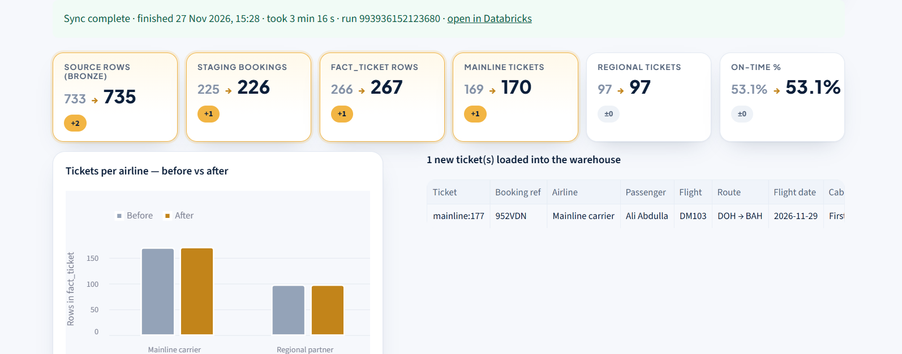<br><sub><b>Sync now</b>: the page-1 booking arrives (bronze +2, staging +1, <code>fact_ticket</code> +1)</sub></td>
</tr>
<tr>
<td colspan="2">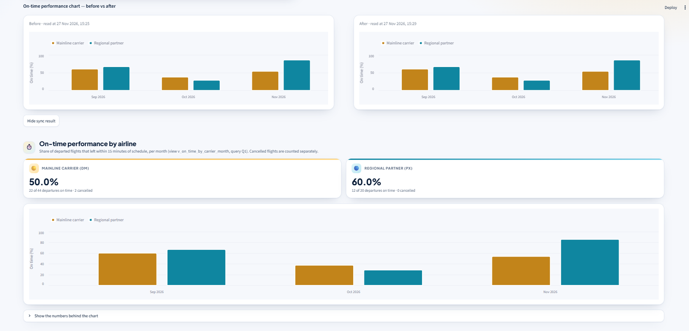<br><sub><b>On-time performance chart</b>: before vs after the sync, and per airline (<code>v_on_time_by_carrier_month</code>)</sub></td>
</tr>
<!-- Page 3 · Passenger feedback (Member 3): add its screenshots here, in the same style -->
<tr><th colspan="2" align="left">📄 Page 4 · Semantic search (Member 1)</th></tr>
<tr>
<td colspan="2">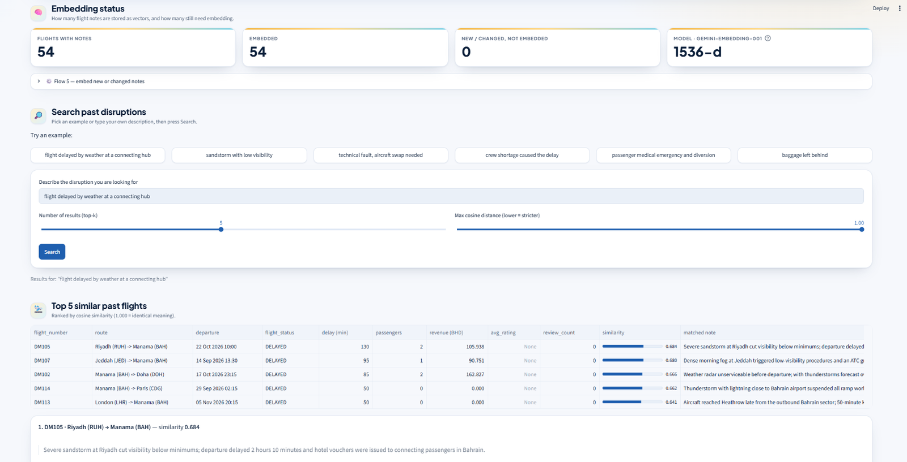<br><sub><b>Semantic search</b>: embedding status, Flow 5 button, and results enriched with route, delay, passengers and revenue</sub></td>
</tr>
</table>

**Built to be safe with real users.** Each booking runs on its own private connection, so two people booking at once never share a transaction. A rare clash (same random reference or seat) is retried automatically, and if it still fails the user sees a clear message instead of a traceback. All times are shown in Bahrain time, and search results stay on screen while you use the rest of the page.

---

## 🧱 Analytical role: Databricks warehouse

*Member 2.* **Flow 1** copies **both** operational schemas from Supabase into Databricks and turns them into **one star schema** in three layers (bronze → staging → gold). The notebooks are in [`databricks/`](databricks/) and run in Databricks from a Git folder. The Job **`airline_etl_flow1`** chains them, and the **Sync now** button on dashboard page 2 starts that Job.

| Layer | Databricks schema | What happens | Notebook |
|---|---|---|---|
| 🥉 Bronze | `workspace.airline_bronze` | all 10 operational tables copied as **raw text**, tagged with `source_system`, `source_table`, `_run_id` and `_extracted_at`; row counts checked against the source | [`01_extract_bronze.py`](databricks/01_extract_bronze.py) |
| 🥈 Staging | `workspace.airline_staging` | typed, cleansed and reconciled `stg_*` tables; every step logged with **before / after row counts** in `etl_audit`; every dropped column listed with its reason in `etl_column_exclusions` | [`02_staging.py`](databricks/02_staging.py) |
| 🥇 Gold | `workspace.airline_gold` | star schema `fact_ticket` + `dim_passenger`, `dim_flight`, `dim_date`, `dim_carrier`, `dim_cabin`, with primary / foreign keys and integrity checks | [`03_gold.py`](databricks/03_gold.py) |
| 📊 Analytics | `workspace.airline_gold` | 5 analytical views (Q1–Q5), used by dashboard page 2 | [`04_analytical_queries.sql`](databricks/04_analytical_queries.sql) |

Shared rules and helpers are in [`_etl_common.py`](databricks/_etl_common.py). [`00_connectivity_test.py`](databricks/00_connectivity_test.py) proves that Databricks can reach Supabase **and that it cannot write to it**.

**Safe by design.** Databricks reads Supabase with the read-only role `etl_reader` ([`11_read_only_role.sql`](sql/postgres/11_read_only_role.sql)) inside a read-only transaction, so the ETL can never change the operational data. The connection string is stored in the Databricks secret scope `airline`, never in code or GitHub.

**Cleansing (staging).**
- **Duplicates:** exact duplicate fare lines are removed. The same person found twice, or in both schemas, becomes **one** passenger (matched on lower-cased email, then name + date of birth; the mainline record wins, otherwise the oldest). `stg_passenger_xref` links every source record to the merged person.
- **NULLs and inconsistent values:** names title-cased, emails lower-cased, city names mapped to IATA codes, four date-of-birth formats parsed, a missing cabin inferred from the fare (within 5 %), a missing fare rebuilt as route fare × cabin multiplier.
- **Dates and currency:** all times in Bahrain time (UTC+3); overnight regional arrivals moved to the next day; USD fares converted to BHD at 0.376.
- **Business rules:** one live seat per person per flight (the earliest booking is kept), and orphan tickets are rejected. A page-2 Sync shows any new ticket that a rule stopped, with the reason.
- **Column exclusion:** 21 source columns are left out (at least 2 per table, including `crew_manifest_ref` and `checkin_kiosk_code`), each with a one-line justification.

**Reconciliation.** `stg_booking` and `stg_passenger` merge the mainline `booking` / `passenger` tables with the regional `reservation` / `traveler` tables. Regional `travel_class` is mapped onto the mainline cabin model. Every regional `fare_line` is checked against route fare × cabin factor (±0.5 %, else `DRIFT`). Every mainline fare is checked against its 0.90–1.15 pricing band (else `OUT_OF_BAND`).

**Star schema.** Grain of `fact_ticket`: **one row per ticket, which is one passenger seat on one flight segment**. Booking reference, status, channel and payment method are kept on the fact as degenerate dimensions. `dim_date` is used twice, as booking date and flight date. Measures are `fare_bhd`, `tax_bhd`, `revenue_bhd` (0 for refunded, void and cancelled tickets) and `ticket_count`.

<p align="center">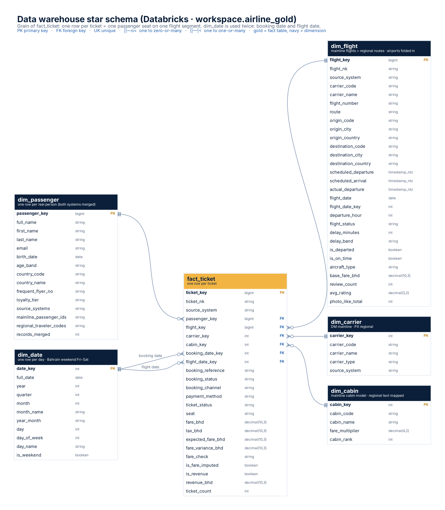</p>

<details>
<summary><b>📐 Operational design vs warehouse design</b> (full ERD of the two source schemas: <a href="docs/assets/erd-operational.png">erd-operational.png</a>)</summary>

<br>

| | Operational (Supabase, 2 schemas) | Warehouse (Databricks star schema) |
|---|---|---|
| **Built for** | running bookings: many small inserts and updates (OLTP) | analysis: large reads, joins and aggregates (OLAP) |
| **Structure** | 10 tables: `mainline_carrier` in 3NF, `regional_partner` denormalised | 1 fact table + 5 dimensions |
| **Keys** | different per schema (`SERIAL` ids vs text codes such as `TRV-0001`) | surrogate keys; source ids kept as `ticket_nk` / `flight_nk` |
| **People** | the same person can exist twice, or in both schemas | one `dim_passenger` row per real person |
| **Flights** | `flight` + `airport` vs `route` with city names | one `dim_flight`, airport details folded in |
| **Cabins** | `cabin_class` table vs free-text `travel_class` | one `dim_cabin`; the text is mapped onto the cabin model |
| **Time and money** | `TIMESTAMPTZ` vs local / UTC `TIMESTAMP`; BHD and USD | Bahrain time; BHD everywhere; `dim_date` for calendar analysis |
| **Columns** | includes personal and technical columns | 21 columns left out (privacy, no analytical value) |

</details>

| | Analytical query (view) | Question it answers |
|---|---|---|
| Q1 | `v_on_time_by_carrier_month` | on-time departures (≤ 15 min late) per airline and month |
| Q2 | `v_revenue_by_route_cabin` | revenue and average fare per route and cabin |
| Q3 | `v_top_passengers` | most frequent travellers across **both** airlines |
| Q4 | `v_ticket_volume_by_carrier_month` | revenue tickets per airline and month (behind the carrier filter) |
| Q5 | `v_fare_reconciliation` | how many fares match the shared fare model, drifted, or were imputed |

**Refresh strategy.**

| | |
|---|---|
| **Job** | `airline_etl_flow1`: `extract_bronze` → `staging` → `gold` → `analytics`, on serverless compute, one run at a time (about 3 minutes) |
| **On demand** | **Sync now** on page 2 calls the Jobs API (`run-now`), follows the run, then compares the warehouse before and after |
| **Nightly** | the same Job also runs on a schedule every night at 03:30 Bahrain time, so the warehouse is never more than a day old (page 2 shows the schedule live) |
| **Full reload** | every layer is rebuilt from the source on each run, so inserts, updates **and deletes** are always in step. Hard deletes are not tracked in the source, and the data is small, so this is simpler and safer than an incremental load |
| **Scale-up option** | incremental loads using the `updated_at` / `last_modified` watermark columns plus a periodic delete reconcile ([notes](docs/schema_design.md#notes-for-member-2-etl--databricks)) |

<details>
<summary><b>🧱 Two-minute check of the warehouse</b> (paste into the Databricks SQL Editor)</summary>

<br>

```sql
-- 1. Star schema row counts
SELECT 'fact_ticket' AS table_name, count(*) AS row_count FROM workspace.airline_gold.fact_ticket
UNION ALL SELECT 'dim_passenger', count(*) FROM workspace.airline_gold.dim_passenger
UNION ALL SELECT 'dim_flight',    count(*) FROM workspace.airline_gold.dim_flight
UNION ALL SELECT 'dim_date',      count(*) FROM workspace.airline_gold.dim_date
UNION ALL SELECT 'dim_carrier',   count(*) FROM workspace.airline_gold.dim_carrier
UNION ALL SELECT 'dim_cabin',     count(*) FROM workspace.airline_gold.dim_cabin;

-- 2. Cleansing audit of the latest run: before / after counts for every step
SELECT layer, table_name, step, rows_before, rows_after, rows_removed, note
FROM workspace.airline_staging.etl_audit
WHERE run_id = (SELECT max(run_id) FROM workspace.airline_staging.etl_audit)
ORDER BY layer, table_name, step;

-- 3. Columns left out of the warehouse, and why
SELECT source_table, column_name, reason FROM workspace.airline_staging.etl_column_exclusions
ORDER BY source_table, column_name;

-- 4. An analytical query: on-time performance per airline and month
SELECT * FROM workspace.airline_gold.v_on_time_by_carrier_month ORDER BY year_month, carrier_name;
```

</details>

## 🍃 NoSQL role: MongoDB Atlas

*Member 3.* **Step 1 (import, Flow 2):** core records are copied from PostgreSQL into `passenger_feedback`, keeping the original `booking_id`, `passenger_id` and `flight_id`. **Step 2 (extend, Flow 3):** data that only exists in MongoDB is added to those documents: embedded `reviews[]` (rating, comment, date) and `photo_likes`, plus a `baggage_events` collection. Includes CRUD on the extended documents, aggregation pipelines (e.g. average rating per flight), an indexing strategy justified with `explain()`, and the **Flow 4** sync-back into PostgreSQL.

---

## 🗂️ Repository structure

```text
airline-flight-booking/
├── dashboard/                     Streamlit app (Flow 7)
│   ├── app.py                     sidebar navigation + home page
│   ├── ui.py                      shared design: banner, KPI cards, section headers, colours
│   ├── pg_utils.py                PostgreSQL connections: shared read + private write
│   ├── dbx_utils.py               Databricks SQL warehouse + Jobs API (page 2)
│   ├── assets/                    logo
│   └── pages/
│       ├── 1_Operational.py       both schemas · comparison toggle · simulate booking
│       ├── 2_Warehouse.py         star schema views · Sync now · carrier filter
│       └── 4_Semantic_Search.py   pgvector search · Flow 5 button
├── databricks/                    analytical role (Flow 1), a Git folder in Databricks
│   ├── 00_connectivity_test.py    Supabase reachable, read-only
│   ├── _etl_common.py             shared cleansing rules and helpers
│   ├── 01_extract_bronze.py       both schemas → bronze (raw text + source_system)
│   ├── 02_staging.py              cleansing, column exclusion, reconciliation, audit
│   ├── 03_gold.py                 star schema, keys, integrity checks
│   └── 04_analytical_queries.sql  5 analytical views (Q1–Q5)
├── sql/postgres/                  operational role (run order above)
│   ├── 01_mainline_carrier_schema.sql      normalised schema, 6 tables
│   ├── 02_regional_partner_schema.sql      denormalised schema, 4 tables
│   ├── 03_mainline_carrier_seed.sql        sample data + planted problems
│   ├── 04_regional_partner_seed.sql        sample data + planted problems
│   ├── 05_crud_mainline_carrier.sql        CRUD demo
│   ├── 06_crud_regional_partner.sql        CRUD demo + update anomaly
│   ├── 07_views_and_queries.sql            3 views + cross-schema query
│   ├── 08_update_flight_notes.sql          one-off live upgrade (applied)
│   ├── 09_close_departed_flights.sql       keeps statuses realistic
│   ├── 10_fix_booking_dates.sql            one-off live upgrade (applied)
│   ├── 11_read_only_role.sql               optional read-only login
│   └── 12_upgrade_live_audit_fixes.sql     one-off live upgrade
├── vector/                        vector role (Flows 5 and 6)
│   ├── 01_pgvector_setup.sql      table · HNSW index · match_flight_notes()
│   ├── 02_similarity_search.sql   search written out in SQL
│   ├── 03_update_match_function.sql
│   ├── embeddings.py              Gemini helper (one model everywhere)
│   ├── embed_flight_notes.py      Flow 5 pipeline (CLI + dashboard)
│   └── similarity_search.py       Flow 6 CLI
├── docs/
│   ├── schema_design.md           column-level design, contracts, ETL notes
│   └── assets/                    README artwork, screenshots and ERDs
├── .streamlit/config.toml         shared light theme for every page
├── .streamlit/secrets.toml.example
├── .env.example
└── requirements.txt
```

Member 3 adds the `mongodb/` scripts and dashboard page 3 (any `pages/3_*.py` file appears in the sidebar and on the home page automatically).

---

## 🛡️ Security and data protection

- **No secrets in Git.** `secrets.toml` and `.env` are ignored in every folder, only `*.example` templates are committed, and GitHub push protection is on. Credentials reach the tutor through the private Moodle note.
- **Row Level Security** is enabled on all 10 operational tables, so Supabase's public API cannot read them. An optional read-only login (`11_read_only_role.sql`) gives `SELECT`-only access for the warehouse or the tutor.
- **Parameterised SQL** everywhere in Python (`%s` placeholders). The only dynamic table names come from a fixed whitelist.
- **Fake personal data only.** Every name, email (`@example.com`) and phone number in the seed data is invented.

---

## 👥 Team and contributions

| Member | Role | Owns |
|---|---|---|
| **Abrar** (Member 1) | Operational & vector engineer | Supabase, both PostgreSQL schemas, seed data, CRUD, views, pgvector Flows 5 & 6, dashboard pages 1 & 4, README |
| **Member 2** | ETL & warehouse engineer | Databricks bronze/staging/star schema, Flow 1, "Sync now", dashboard page 2 |
| **Member 3** | NoSQL & dashboard lead | MongoDB Atlas, Flows 2, 3 & 4, Streamlit app shell and deployment, dashboard page 3 |

Every member commits from their **own GitHub account**, in small, described steps. See the [commit history](https://github.com/it8417-group2-airline/airline-flight-booking/commits/main).

---

<details>
<summary><b>🛠️ Troubleshooting</b></summary>

<br>

| Problem | Fix |
|---|---|
| `PostgreSQL is not configured` | Run Streamlit **from the repository root** (`streamlit run dashboard/app.py`) so it finds `.streamlit/secrets.toml`, or set `DATABASE_URL`. |
| `password authentication failed` | The password in the connection string is wrong or was reset. Take it from the Moodle note (Supabase → Project Settings → Database). |
| `GEMINI_API_KEY is not set` | Add `[embeddings] GEMINI_API_KEY` to `secrets.toml` (dashboard) or `$env:GEMINI_API_KEY` (CLI). |
| `streamlit` is not recognised | Activate the virtual environment first: `.venv\Scripts\Activate.ps1`. |
| Pages crash with `width="stretch"` | Streamlit is older than 1.50: `pip install -r requirements.txt --upgrade`. |
| A departed flight still says SCHEDULED | Run `SELECT * FROM mainline_carrier.close_departed_flights();` in the Supabase SQL Editor. |
| Page 4 shows "New / changed, not embedded" above 0 | Open **Flow 5** on page 4 and click **Run embedding pipeline** (only changed notes are embedded). |
| Supabase project is paused | Free projects pause after about a week without activity: open the project and click **Restore**. |

</details>

<details>
<summary><b>📚 References</b></summary>

<br>

- pgvector: open-source vector similarity search for Postgres. <https://github.com/pgvector/pgvector>
- Supabase docs: pgvector extension. <https://supabase.com/docs/guides/database/extensions/pgvector>
- Google AI for Developers: Gemini embeddings. <https://ai.google.dev/gemini-api/docs/embeddings>
- Streamlit documentation. <https://docs.streamlit.io>
- Databricks documentation. <https://docs.databricks.com>
- MongoDB Atlas documentation. <https://www.mongodb.com/docs/atlas/>

</details>

<div align="center">
<br>
<sub>IT8417 Advanced Cloud Databases · BSc Applied Data Analytics · Bahrain Polytechnic · Semester 1, 2026–2027 · Group 2</sub>
</div>
