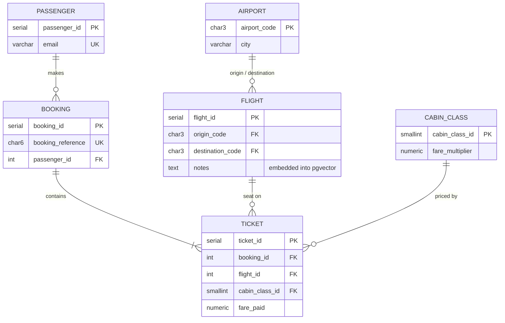
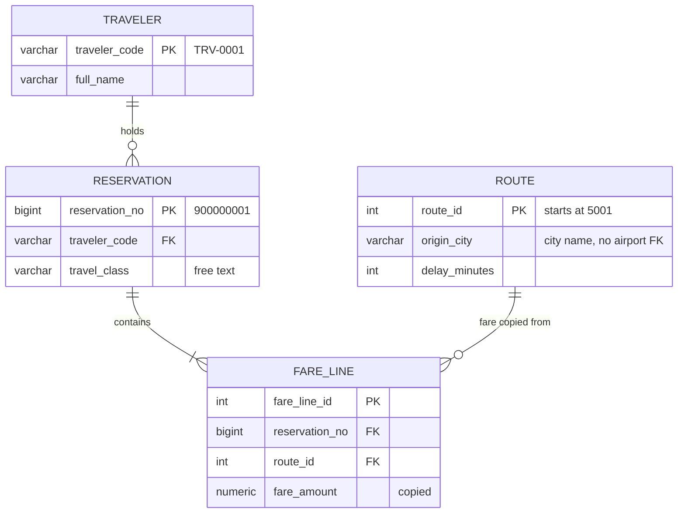

# Operational schema design: PostgreSQL on Supabase

> **Owner:** Abrar (Member 1) · **Schemas:** `mainline_carrier` (normalised, 6 tables) and `regional_partner` (denormalised, 4 tables), plus `vector_store` (pgvector)
> **Status:** frozen. Table and column names below are the contract that Member 2 (ETL) and Member 3 (MongoDB / Flow 4) build on. Changes are announced in the group chat first.

**Contents:** [Run order](#run-order) · [ER diagrams](#er-diagrams) · [Entity mapping](#entity-mapping) · [mainline_carrier](#schema-mainline_carrier-normalised-3nf) · [regional_partner](#schema-regional_partner-deliberately-denormalised) · [vector_store](#schema-vector_store-pgvector) · [Views and functions](#views-and-functions) · [Planted data-quality issues](#planted-data-quality-issues) · [Notes for Member 2](#notes-for-member-2-etl--databricks) · [Contract for Member 3](#contract-for-member-3-mongodb--flow-4)

Legend: **PK** primary key · **FK** foreign key · **UQ** unique · **NN** not null · 🗑️ = dropped by the ETL (not needed downstream; at least 2 per table)

---

## Run order

| Step | File | When |
|---:|---|---|
| 1 | `sql/postgres/01_mainline_carrier_schema.sql` | fresh build only (drops the schema) |
| 2 | `sql/postgres/02_regional_partner_schema.sql` | fresh build only (drops the schema) |
| 3 | `sql/postgres/03_mainline_carrier_seed.sql` | fresh build only (empty tables) |
| 4 | `sql/postgres/04_regional_partner_seed.sql` | fresh build only (empty tables) |
| 5 | `sql/postgres/07_views_and_queries.sql` | any time (re-creates the views) |
| 6 | `vector/01_pgvector_setup.sql` | fresh build only (drops the embeddings) |
| 7 | `sql/postgres/09_close_departed_flights.sql` | any time, and before every demo |
| 8 | `python vector/embed_flight_notes.py` | after 6, and whenever notes change |
| – | `05`, `06` (CRUD demos), `vector/02` (search demo) | any time, they clean up after themselves |
| – | `08`, `10`, `12`, `vector/03` | one-off upgrades of the live database (already applied on Supabase) |
| – | `11_read_only_role.sql` | optional, only if a separate read-only login is wanted |

If `01` is ever re-run, re-run `03`, `07` and `09` too: `01` drops the views and `close_departed_flights()`, and restores the embeddings foreign key itself.

---

## ER diagrams

### `mainline_carrier`: normalised (3NF)



### `regional_partner`: deliberately denormalised



---

## Entity mapping

| Entity | `mainline_carrier` | `regional_partner` | Structural difference (deliberate) |
|---|---|---|---|
| Customer | `passenger` | `traveler` | `first_name` + `last_name` vs one `full_name`; SERIAL key vs text key `TRV-0001`; `DATE` vs birth date as text |
| Flight | `flight` (+ `airport`) | `route` | airport-code FKs vs free-text city names; actual times vs `delay_minutes`; one timestamp vs date + time |
| Booking | `booking` | `reservation` | SERIAL vs BIGINT key; class on each ticket vs one `travel_class` text |
| Ticket | `ticket` | `fare_line` | price from `base_fare × fare_multiplier` vs `fare_amount` copied from `route` |
| Cabin | `cabin_class` | (none) | lookup table vs free text `'Economy'`, `'ECONOMY'`, `'econ'`, `'Y'` … |
| Audit column | `updated_at TIMESTAMPTZ` | `last_modified TIMESTAMP` (UTC) | different name and type on purpose |

---

## Schema `mainline_carrier` (normalised, 3NF)

### `airport`

| Column | Type | Rules | Notes |
|---|---|---|---|
| `airport_code` | `CHAR(3)` | **PK** | IATA code, e.g. `BAH` |
| `airport_name` | `VARCHAR(120)` | NN | |
| `city` | `VARCHAR(80)` | NN | |
| `country_code` | `CHAR(2)` | NN | ISO code, e.g. `BH` |
| `is_hub` | `BOOLEAN` | NN, default `FALSE` | `TRUE` for BAH, DOH |
| `timezone_name` | `VARCHAR(40)` | | 🗑️ operational only |
| `terminal_count` | `SMALLINT` | | 🗑️ operational only |

*Why:* each airport is stored once; flights point to it by code. 12 rows.

### `cabin_class`

| Column | Type | Rules | Notes |
|---|---|---|---|
| `cabin_class_id` | `SMALLINT` | **PK** | |
| `cabin_code` | `CHAR(1)` | NN, UQ | `Y`, `W`, `J`, `F` |
| `cabin_name` | `VARCHAR(30)` | NN, UQ | |
| `fare_multiplier` | `NUMERIC(4,2)` | NN, `>= 1` | 1.00, 1.45, 2.60, 4.10 |
| `lounge_access_code` | `VARCHAR(10)` | | 🗑️ |
| `display_colour` | `VARCHAR(7)` | | 🗑️ |

*Why:* "Business" is stored once, so it cannot be misspelt. The regional schema uses free text instead.

### `passenger`

| Column | Type | Rules | Notes |
|---|---|---|---|
| `passenger_id` | `SERIAL` | **PK** | |
| `first_name` | `VARCHAR(60)` | NN | |
| `last_name` | `VARCHAR(60)` | NN | |
| `email` | `VARCHAR(120)` | UQ | match key across schemas (`lower(email)`) |
| `date_of_birth` | `DATE` | | |
| `nationality` | `CHAR(2)` | | |
| `frequent_flyer_no` | `VARCHAR(12)` | | |
| `phone` | `VARCHAR(20)` | | 🗑️ personal data, not needed for analytics |
| `passport_scan_ref` | `VARCHAR(40)` | | 🗑️ personal data |
| `created_at` | `TIMESTAMPTZ` | NN, default `now()` | |
| `updated_at` | `TIMESTAMPTZ` | NN, trigger | ETL watermark |

### `flight`

| Column | Type | Rules | Notes |
|---|---|---|---|
| `flight_id` | `SERIAL` | **PK** | |
| `flight_number` | `VARCHAR(8)` | NN | e.g. `DM104` |
| `origin_code` | `CHAR(3)` | NN, **FK** → `airport` | |
| `destination_code` | `CHAR(3)` | NN, **FK** → `airport` | `<> origin_code` |
| `scheduled_departure` | `TIMESTAMPTZ` | NN | |
| `scheduled_arrival` | `TIMESTAMPTZ` | NN, `> scheduled_departure` | |
| `actual_departure` | `TIMESTAMPTZ` | | NULL until it departs |
| `actual_arrival` | `TIMESTAMPTZ` | | |
| `flight_status` | `VARCHAR(10)` | NN | `SCHEDULED`, `LANDED`, `DELAYED`, `CANCELLED`, `DIVERTED` |
| `aircraft_type` | `VARCHAR(20)` | | |
| `base_fare` | `NUMERIC(10,3)` | NN, `> 0` | BHD, Economy price |
| `notes` | `TEXT` | | disruption notes, embedded into pgvector (Flow 5) |
| `crew_manifest_ref` | `VARCHAR(30)` | | 🗑️ (named in the task division) |
| `gate_code` | `VARCHAR(5)` | | 🗑️ |
| `review_count` | `INTEGER` | NN, default 0 | **Flow 4 target**, written by Member 3 |
| `avg_rating` | `NUMERIC(3,2)` | NULL or 1–5 | **Flow 4 target** |
| `photo_like_total` | `INTEGER` | NN, default 0 | **Flow 4 target** |
| `updated_at` | `TIMESTAMPTZ` | NN, trigger | ETL watermark |

*Why:* two FKs to `airport` (from/to). Actual times let the views calculate delays.

### `booking`

| Column | Type | Rules | Notes |
|---|---|---|---|
| `booking_id` | `SERIAL` | **PK** | |
| `booking_reference` | `CHAR(6)` | NN, UQ | PNR, e.g. `K7XQ2M` |
| `passenger_id` | `INTEGER` | NN, **FK** → `passenger` | |
| `booking_date` | `TIMESTAMPTZ` | NN, default `now()` | always before the flight |
| `booking_status` | `VARCHAR(10)` | NN | `CONFIRMED`, `COMPLETED`, `CANCELLED` |
| `booking_channel` | `VARCHAR(6)` | NN | `WEB`, `APP`, `AGENT` |
| `payment_method` | `VARCHAR(20)` | | |
| `session_ip` | `INET` | | 🗑️ |
| `agent_remarks` | `TEXT` | | 🗑️ |
| `updated_at` | `TIMESTAMPTZ` | NN, trigger | ETL watermark |

### `ticket`: links one booking to one flight

| Column | Type | Rules | Notes |
|---|---|---|---|
| `ticket_id` | `SERIAL` | **PK** | |
| `ticket_number` | `VARCHAR(14)` | NN, UQ | |
| `booking_id` | `INTEGER` | NN, **FK** → `booking` ON DELETE CASCADE | |
| `flight_id` | `INTEGER` | NN, **FK** → `flight` | |
| `cabin_class_id` | `SMALLINT` | NN, **FK** → `cabin_class` | |
| `seat_number` | `VARCHAR(4)` | UQ with `flight_id` | no double-booked seats |
| `fare_paid` | `NUMERIC(10,3)` | NN, `>= 0` | price at time of sale |
| `ticket_status` | `VARCHAR(8)` | NN | `ISSUED`, `USED`, `REFUNDED`, `VOID` |
| `baggage_tag_ref` | `VARCHAR(20)` | | 🗑️ |
| `issued_terminal_id` | `VARCHAR(10)` | | 🗑️ |
| `updated_at` | `TIMESTAMPTZ` | NN, trigger | ETL watermark |

*Why:* `fare_paid` is stored because the price paid must not change if `base_fare` changes later.

---

## Schema `regional_partner` (deliberately denormalised)

### `traveler` (= passenger)

| Column | Type | Rules | Notes |
|---|---|---|---|
| `traveler_code` | `VARCHAR(10)` | **PK** | text key, e.g. `TRV-0001` |
| `full_name` | `VARCHAR(120)` | NN | one field, mixed casing |
| `email_address` | `VARCHAR(150)` | | **not** unique, so duplicates are possible |
| `birth_date_text` | `VARCHAR(20)` | | date as TEXT in 4 formats |
| `country` | `VARCHAR(60)` | | free text (`'Bahrain'`, `'BAHRAIN'`, `'KSA'` …) |
| `loyalty_tier` | `VARCHAR(10)` | | Blue, Silver, Gold |
| `registered_on` | `DATE` | NN, default today (Bahrain) | |
| `mobile_no` | `VARCHAR(20)` | | 🗑️ |
| `sms_opt_in` | `CHAR(1)` | `'Y'`/`'N'` | 🗑️ |
| `last_modified` | `TIMESTAMP` | NN, trigger | **UTC**, ETL watermark |

### `route` (= flight)

| Column | Type | Rules | Notes |
|---|---|---|---|
| `route_id` | `INTEGER` identity | **PK** | starts at 5001 |
| `route_code` | `VARCHAR(10)` | NN | e.g. `PX210` |
| `origin_city` | `VARCHAR(60)` | NN | city **name**, no airport table, mixed casing/aliases |
| `destination_city` | `VARCHAR(60)` | NN | |
| `departure_date` | `DATE` | NN | Bahrain local |
| `departure_time` | `TIME` | NN | Bahrain local |
| `arrival_time` | `TIME` | NN | |
| `delay_minutes` | `INTEGER` | | instead of actual times; NULL = not reported |
| `route_status` | `VARCHAR(15)` | | free text: `scheduled`, `operated`, `delayed` (any casing) |
| `fare_amount` | `NUMERIC(9,3)` | NN | Economy fare, BHD |
| `aircraft_reg` | `VARCHAR(10)` | | 🗑️ |
| `ops_remark` | `TEXT` | | 🗑️ |
| `last_modified` | `TIMESTAMP` | NN, trigger | **UTC**, ETL watermark |

### `reservation` (= booking)

| Column | Type | Rules | Notes |
|---|---|---|---|
| `reservation_no` | `BIGINT` | **PK** | e.g. `900000001` (seed ≤ 900000080) |
| `pnr` | `VARCHAR(8)` | NN | |
| `traveler_code` | `VARCHAR(10)` | NN, **FK** → `traveler` | |
| `travel_class` | `VARCHAR(20)` | | one free-text field, no cabin table |
| `reserved_at` | `TIMESTAMP` | NN, default now (Bahrain) | **Bahrain local**, always before the route |
| `reservation_status` | `VARCHAR(15)` | NN | `Confirmed`, `confirmed`, `Flown`, `CANCELLED`, `cxl` |
| `sales_channel` | `VARCHAR(20)` | | |
| `checkin_kiosk_code` | `VARCHAR(10)` | | 🗑️ (named in the task division) |
| `agent_terminal` | `VARCHAR(10)` | | 🗑️ |
| `last_modified` | `TIMESTAMP` | NN, trigger | **UTC**, ETL watermark |

### `fare_line` (= ticket)

| Column | Type | Rules | Notes |
|---|---|---|---|
| `fare_line_id` | `INTEGER` identity | **PK** | |
| `reservation_no` | `BIGINT` | NN, **FK** → `reservation` ON DELETE CASCADE | |
| `route_id` | `INTEGER` | NN, **FK** → `route` | |
| `fare_amount` | `NUMERIC(9,3)` | | **copied** from `route.fare_amount × class factor` at sale time |
| `tax_amount` | `NUMERIC(9,3)` | default 0 | 10 % of the fare |
| `currency` | `VARCHAR(3)` | NN, default `'BHD'` | `'BHD'`, `'bhd'`, `'USD'` |
| `seat_label` | `VARCHAR(4)` | | |
| `line_status` | `VARCHAR(12)` | | `active` (route not departed), `used` (departed), `void` (cancelled) |
| `promo_code` | `VARCHAR(12)` | | 🗑️ |
| `legacy_fare_basis` | `VARCHAR(10)` | | 🗑️ |
| `last_modified` | `TIMESTAMP` | NN, trigger | **UTC**, ETL watermark |

*Why:* the fare is copied from the route, so if the route price changes, old lines keep the old price. File `06` shows this update anomaly.

---

## Schema `vector_store` (pgvector)

### `flight_note_embeddings`

| Column | Type | Rules | Notes |
|---|---|---|---|
| `embedding_id` | `BIGINT` identity | **PK** | |
| `flight_id` | `INTEGER` | NN, **FK** → `mainline_carrier.flight` ON DELETE CASCADE | |
| `source_type` | `VARCHAR(20)` | NN | `flight_notes` or `mongo_review` |
| `source_ref` | `VARCHAR(64)` | NN, default `''` | MongoDB review id, `''` for flight notes |
| `notes` | `TEXT` | NN | the exact text that was embedded |
| `content_hash` | `CHAR(32)` | NN | `md5(notes)`, so unchanged text is not re-embedded |
| `embedding` | `vector(1536)` | NN | Gemini `gemini-embedding-001`, 1536 dimensions, normalised |
| `model_name` | `VARCHAR(60)` | NN | |
| `created_at` | `TIMESTAMPTZ` | NN | |

UQ (`flight_id`, `source_type`, `source_ref`) · HNSW index `idx_flight_note_emb_hnsw` (`vector_cosine_ops`, m = 16, ef_construction = 64).

*Why Gemini and not OpenAI `text-embedding-3-small`:* the task division names OpenAI only as an example of "a 1536-dimension model". Gemini `gemini-embedding-001` gives the same 1536 dimensions (`output_dimensionality = 1536`) on a free tier, uses separate task types for documents (`RETRIEVAL_DOCUMENT`) and search queries (`RETRIEVAL_QUERY`), and needs no paid account. The same model must embed the notes and the queries.

---

## Views and functions

| Object | File | Purpose |
|---|---|---|
| `mainline_carrier.v_on_time_performance_by_route` | 07 | Q1: on-time % per route, flight + airport ×2 + ticket join |
| `regional_partner.v_revenue_per_cabin` | 07 | Q2: revenue per cabin, cleans free-text class, converts USD |
| `regional_partner.v_route_performance` | 07 | Q3: Q1 on the other schema; `delay_not_reported` counts NULL delays |
| `mainline_carrier.close_departed_flights()` | 09 | closes departed flights and routes in both schemas (see the file header) |
| `mainline_carrier.simulated_delay_min(id)` | 09 | repeatable delay for auto-closed flights (70 % on time) |
| `vector_store.match_flight_notes(vec, k, max_dist)` | vector/01, vector/03 | Flow 6: cosine search over past flights + relational enrichment |

---

## Planted data-quality issues

These are deliberate, for Member 2's cleansing step (listed in the headers of `03` and `04`).

| Schema | Issue |
|---|---|
| mainline | passenger 41 duplicates 1 (UPPER-case name), 42 duplicates 5 (lower-case name, UPPER-case email) |
| mainline | NULL email (12), NULL date of birth (26), NULL nationality (34), NULL notes (flights 9, 31), NULL `actual_arrival` (flight 23), some NULL `payment_method` |
| mainline | double bookings: passenger 17 has two live tickets on flight 93 (tickets 98, 165), passenger 24 two on flight 45 (tickets 73, 75) |
| both | the same 10 people exist in both schemas (`TRV-0001`…`TRV-0010` = passengers 1, 2, 3, 6, 9, 14, 17, 21, 23, 30; match on `lower(email)`) |
| regional | `TRV-0031` duplicates `TRV-0011`, `TRV-0032` duplicates `TRV-0016` |
| regional | birth dates in 4 text formats; country, city, class and status in mixed casing / aliases |
| regional | currency `BHD` / `bhd` / `USD`; some fares drift from `route.fare_amount × factor`; NULL `fare_amount` on lines 17 and 44; lines 100–102 are exact copies of 3, 20, 33 |
| regional | `delay_minutes` NULL on 2 operated routes (counted in `delay_not_reported`) |

---

## Notes for Member 2 (ETL / Databricks)

**1. Incremental refresh (watermarks).**

| Schema | Watermark column | Type | Time zone |
|---|---|---|---|
| `mainline_carrier` (passenger, flight, booking, ticket) | `updated_at` | `TIMESTAMPTZ` | absolute instant |
| `regional_partner` (all 4 tables) | `last_modified` | `TIMESTAMP` | **UTC** (set by trigger and default, whatever the session time zone) |

- `airport` and `cabin_class` have no audit column. They are small lookup tables, so reload them in full on each run.
- Hard deletes are **not tracked**: the CRUD demos (`05`, `06`) delete their own test rows, and `ON DELETE CASCADE` removes tickets / fare lines with their booking. Use a periodic full reconcile (anti-join on keys) to remove rows that no longer exist.

**2. Fares.**
- `ticket.fare_paid` in the seed = `base_fare × fare_multiplier × 0.90–1.15` on purpose (early-bird / last-minute pricing). Bookings from the CRUD script and the dashboard use factor 1.00. Use `fare_paid` as the revenue measure; don't recompute it.
- `fare_line.fare_amount` = `route.fare_amount × class factor`, copied at sale time: Economy 1.00, Premium Economy 1.45, Business 2.60 (the same factors as mainline `cabin_class`). Some lines drift on purpose; USD lines need × 0.376 to become BHD.

**3. City → airport code mapping** (`route` stores city names; `mainline_carrier.airport` has no row for the last five).

| City text in `route` (any casing) | IATA | Airport |
|---|---|---|
| Manama, Bahrain | `BAH` | Bahrain International |
| Doha | `DOH` | Hamad International |
| Dubai | `DXB` | Dubai International |
| Kuwait, Kuwait City | `KWI` | Kuwait International |
| Muscat | `MCT` | Muscat International |
| Dammam | `DMM` | King Fahd International |
| Al Ula, AlUla | `ULH` | AlUla International |
| Salalah | `SLL` | Salalah International |
| Shiraz | `SYZ` | Shiraz International |
| Taif | `TIF` | Taif International |

**4. Time zones.** `route.departure_date/time` and `reservation.reserved_at` are Bahrain local time (UTC+3). Mainline timestamps are `TIMESTAMPTZ`. Convert regional local times with `AT TIME ZONE 'Asia/Bahrain'` before comparing.

**5. Status rules** (kept true by `close_departed_flights()`): departed flights are `LANDED` or `DELAYED`, and their tickets are `USED`; regional lines are `used` once their route has departed and `active` before.

**6. Connection.** Databricks uses the owner connection string (session pooler, port 5432), shared privately. RLS is enabled on all 10 tables to block Supabase's public API. The owner is not affected, but any other login sees 0 rows. If a separate read-only login is wanted, run `sql/postgres/11_read_only_role.sql`; it adds `SELECT` policies for the role `etl_reader`.

---

## Contract for Member 3 (MongoDB / Flow 4)

**Flow 4 sync-back:** write the aggregated values into the columns on `mainline_carrier.flight` (columns instead of a separate `flight_feedback_summary` table; the task division allows either). Use this exact statement, which fits the constraints (`review_count` and `photo_like_total` are NOT NULL; `avg_rating` must be NULL or 1.00–5.00):

```sql
UPDATE mainline_carrier.flight
SET    review_count     = COALESCE(%(review_count)s, 0),
       avg_rating       = %(avg_rating)s,          -- NULL or 1.00-5.00, rounded to 2 decimals
       photo_like_total = COALESCE(%(photo_like_total)s, 0)
WHERE  flight_id = %(flight_id)s;
```

The `updated_at` trigger fires, so Member 2's next incremental load picks the change up.

**MongoDB settings read by Flow 5** (`vector/embed_flight_notes.py`, also the checkbox on dashboard page 4). The first match wins:

| Setting | Environment variable | Streamlit secret (top level) | Streamlit secret (section) | Default |
|---|---|---|---|---|
| connection string | `MONGO_URI` | `MONGO_URI` | `[mongo] uri` | none (MongoDB step skipped, with a message) |
| database name | `MONGO_DB` | `MONGO_DB` | `[mongo] db` | `airline` |

Expected document shape in `passenger_feedback`: `{ flight_id: <int>, reviews: [ { review_id, rating, comment, date } ], photo_likes }`. Reviews whose `flight_id` is not in `mainline_carrier.flight` are skipped and counted in the log, so they never abort the batch.
